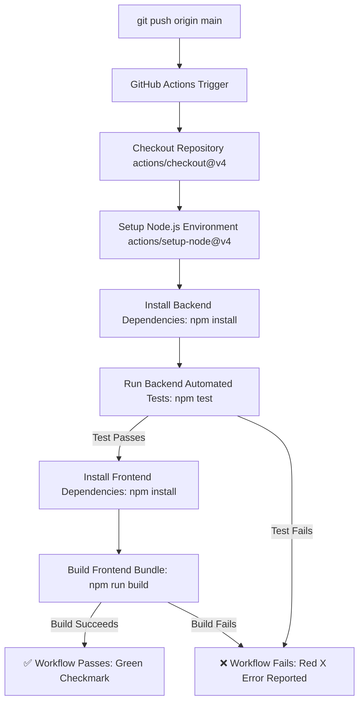

# Practical 12 - CI/CD Pipeline Using GitHub Actions (Full-Stack MERN)

This repository contains Practical 12: an automated **Continuous Integration and Continuous Deployment (CI/CD)** pipeline implemented with **GitHub Actions** for the full-stack MERN Task Management application.

---

## 🎯 Aim

To automate testing, building, and validation of the application using a CI/CD pipeline with GitHub Actions upon pushes and pull requests to the `main` branch.

---

## 📁 Project Structure

```text
pra-12/
├── .github/
│   └── workflows/
│       └── ci-cd.yml          # GitHub Actions workflow configuration
├── backend/                  # Express REST API Server
│   ├── models/               # Mongoose Data Models (Task.js)
│   ├── tests/                # Automated Unit Tests
│   │   └── task.test.js      # Task schema validation test suite (node:test)
│   ├── package.json          # Backend dependencies & npm test script
│   └── server.js             # Express application server
├── frontend/                 # React Single Page Application (Vite)
│   ├── src/                  # React components, pages, and styles
│   ├── package.json          # Frontend dependencies & build script
│   └── vite.config.js        # Vite configuration
├── docker-compose.yml        # Multi-container orchestration (Frontend, Backend, MongoDB)
├── .gitignore                # Git ignore configuration
└── README.md                 # Practical documentation
```

---

## ⚡ Architecture Flow Diagram



---

## 🧪 Automated Unit Testing

The backend includes a lightweight, self-contained unit test suite built with Node.js's native test runner (`node:test` and `node:assert`). It validates:

1. **Instance Creation**: Verifies that tasks initialize with correct properties and default values.
2. **Required Fields**: Asserts that omitting `title` triggers Mongoose schema validation rejection.
3. **Default Assignment**: Validates default values (`completed: false`, `description: ""`, `assignedUser: "Unassigned"`).
4. **Constraint Verification**: Ensures fully-formed tasks validate cleanly without errors.

> **MongoDB Decoupling**: Because `task.validate()` validates the schema constraints in-memory, the tests execute in milliseconds without requiring an external MongoDB connection or active database service.

### Running Tests Locally

```bash
cd backend
npm install
npm test
```

Expected output:
```text
▶ Task Model Validation Tests
  ✔ should create a valid task instance with provided data
  ✔ should require a title and reject validation when title is missing
  ✔ should apply default values when optional fields are omitted
  ✔ should successfully validate when all required constraints are satisfied
✔ Task Model Validation Tests
ℹ tests 4
ℹ pass 4
ℹ fail 0
```

---

## 🔄 Experimentation & Demonstration Guide

### Experiment 1: Demonstrating a Failed Pipeline (Red ❌)

1. Open `backend/tests/task.test.js` and modify line 17 to an intentionally incorrect assertion:
   ```javascript
   // Change from false to true to deliberately break the test
   assert.strictEqual(task.completed, true);
   ```
2. Commit and push the deliberate failure:
   ```bash
   git add backend/tests/task.test.js
   git commit -m "test: deliberately break assertion for CI failure demo"
   git push origin main
   ```
3. Navigate to the **Actions** tab on GitHub:
   - Observe the workflow running automatically.
   - The test fails at step **5. Run Backend Automated Unit Tests**.
   - The workflow terminates with a non-zero exit code and displays a **Red ❌**.

### Experiment 2: Demonstrating a Successful Pipeline (Green ✔️)

1. Correct the assertion back to the valid state in `backend/tests/task.test.js`:
   ```javascript
   assert.strictEqual(task.completed, false);
   ```
2. Commit and push the fix:
   ```bash
   git add backend/tests/task.test.js
   git commit -m "fix: correct test assertion for CI success demo"
   git push origin main
   ```
3. Return to the **Actions** tab on GitHub:
   - The workflow executes all steps: Checkout $\to$ Setup Node $\to$ Install Dependencies $\to$ Run Tests $\to$ Build Frontend.
   - All steps complete with exit code 0 and display a **Green ✔️**.

---

## 🛠️ Tech Stack

- **CI/CD Platform**: GitHub Actions (`actions/checkout@v4`, `actions/setup-node@v4`)
- **Test Runner**: Node.js Native Test Framework (`node:test`, `node:assert`)
- **Frontend**: React 19, Vite, React Router DOM
- **Backend**: Node.js 20, Express 5, Mongoose ORM, `node-cache`
- **Containerization**: Docker, Docker Compose
